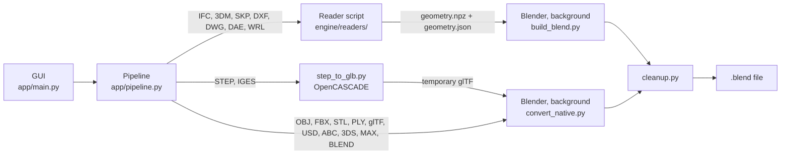

# 3DConvert

Drop 3D files, get clean `.blend` files.

3DConvert is a portable Windows program that converts 3D files from many CAD, BIM and DCC formats into Blender files. It runs Blender in the background (no Blender window opens), keeps the geometry at its original coordinates and tidies the result with 30 optional cleanup steps.

- **Local only.** Files are never uploaded. The program and the Blender it starts make no network connections (Blender runs with factory settings, so its online access stays off).
- **Portable.** One `.exe`, no installer. Blender itself is not included and must be installed.
- **Many formats.** IFC, Rhino, SketchUp, DXF/DWG, COLLADA, STEP, IGES, VRML/X3D, 3MF, AMF, 3ds Max, GIS data (GeoJSON, Shapefile, GeoPackage, KML, GPX, OSM, GeoTIFF terrain), point clouds (LAS/LAZ, E57, PTS, XYZ, PCD), older game and DCC formats (ASSIMP) and everything Blender imports natively. The file icon in the title bar lists every supported program, its extensions and whether it has been tested.
- **Cleanup included.** Duplicate vertices, normals, materials, hidden objects, orphan data and more are handled automatically. Every step can be switched off.

> Version 1.21. Large parts of this program were written with AI assistance. Expect bugs and check the result before relying on it. There is no warranty (see [License](#license)).

## Contents

- [Supported formats](#supported-formats)
- [Requirements](#requirements)
- [Using the program](#using-the-program)
- [What ends up in the .blend](#what-ends-up-in-the-blend)
- [Cleanup steps](#cleanup-steps)
- [How it works](#how-it-works)
- [Repository layout](#repository-layout)
- [Building from source](#building-from-source)
- [Bundled libraries](#bundled-libraries)
- [Limitations](#limitations)
- [License](#license)

## Supported formats

| Format | Extensions | Converted by | Needs |
|---|---|---|---|
| Blender | `.blend` | opened and cleaned | Blender |
| Wavefront OBJ | `.obj` | Blender importer | Blender |
| FBX | `.fbx` | Blender importer | Blender |
| STL | `.stl` | Blender importer | Blender |
| Stanford PLY | `.ply` | Blender importer | Blender |
| glTF | `.gltf` `.glb` | Blender importer | Blender |
| USD | `.usd` `.usda` `.usdc` `.usdz` | Blender importer | Blender |
| Alembic | `.abc` | Blender importer | Blender |
| 3D Studio | `.3ds` | built-in reader (meshes, per-face materials, diffuse colours) | Blender |
| 3ds Max | `.max` | bundled *Import Autodesk MAX* add-on | Blender |
| 3MF | `.3mf` | built-in reader (meshes, components, base materials and colour groups, units) | Blender 5.x |
| AMF | `.amf` | built-in reader (plain or zipped XML; volumes, colours, constellations, units) | Blender 5.x |
| IFC (BIM) | `.ifc` | IfcOpenShell, or a direct reader for files that already contain meshes | Blender 5.x |
| IFC zipped / XML | `.ifczip` `.ifcxml` | unzipped, or converted to IFC text with IfcOpenShell, then as `.ifc` | Blender 5.x |
| Rhino | `.3dm` | rhino3dm | Blender 5.x |
| SketchUp | `.skp` | SketchUp C API binding (optional), else OpenSKP (MIT) | Blender 5.x |
| COLLADA | `.dae` | built-in reader | Blender 5.x |
| AutoCAD DXF | `.dxf` | ezdxf | Blender 5.x |
| AutoCAD DWG | `.dwg` | ODA File Converter (to DXF) when installed, else the bundled LibreDWG (to DXF), then ezdxf | Blender 5.x |
| VRML / X3D | `.wrl` `.x3d` `.x3dv` | built-in readers (VRML97, X3D XML and classic encoding) | Blender 5.x |
| STEP | `.stp` `.step` | OpenCASCADE (via cascadio) to glTF, then Blender | Blender 5.x |
| IGES | `.igs` `.iges` | OpenCASCADE (via cascadio) to glTF, then Blender | Blender 5.x |
| GeoJSON | `.geojson` `.json` | built-in reader: polygons (holes kept) become faces, lines edges, points loose vertices | Blender 5.x |
| Shapefile | `.shp` | built-in reader (polygon holes, lines, points, Z values; `.prj` for the unit) | Blender 5.x |
| GeoPackage | `.gpkg` | built-in reader (SQLite + WKB); one object per layer | Blender 5.x |
| Google Earth | `.kml` `.kmz` | built-in reader (placemarks, paths, polygons); a `.kmz` that only holds a COLLADA model is read as `.dae` | Blender 5.x |
| GPX | `.gpx` | built-in reader (tracks and routes as lines, waypoints as points) | Blender 5.x |
| OpenStreetMap | `.osm` | built-in reader (closed building/area ways as faces, other ways as lines, tagged nodes as points; no heights) | Blender 5.x |
| GeoTIFF | `.tif` `.tiff` | built-in TIFF decoder (strips or tiles; none, Deflate, LZW, PackBits, LZMA; both predictors) and GeoTIFF tags (or a world file); quads for every cell with four valid corners | Blender 5.x |
| ESRI ASCII grid | `.asc` | built-in reader, quads like GeoTIFF; an `.asc` without grid header is read as an x y z point cloud | Blender 5.x |
| LAS / LAZ | `.las` `.laz` | laspy (+ lazrs for LAZ), into a Blender point cloud | Blender 5.x |
| E57 | `.e57` | pye57, all scans merged, into a Blender point cloud | Blender 5.x |
| PTS / XYZ | `.pts` `.xyz` | built-in text reader (xyz, intensity, colours) | Blender 5.x |
| PCD | `.pcd` | built-in reader (ASCII, binary, binary compressed) | Blender 5.x |
| DirectX, LightWave, Quake, MilkShape, Source, AC3D, ASE, trueSpace, OFF | `.x` `.lwo` `.lws` `.md2` `.md3` `.md5mesh` `.ms3d` `.smd` `.ac` `.ase` `.cob` `.off` | ASSIMP (assimp_py): static pose, scene graph flattened | Blender 5.x |
| VRM | `.vrm` | read as glTF binary | Blender |
| Compressed VRML / X3D | `.wrz` `.x3dz` | gunzipped, then as `.wrl` / `.x3d` | Blender 5.x |
| Unity package | `.unitypackage` | the models inside (FBX, OBJ, COLLADA, glTF, STL, PLY, 3DS) are extracted and converted; several models become one collection each | Blender |

Closed formats that cannot be read directly (Navisworks, Revit, Fusion 360, MicroStation, SOLIDWORKS, Inventor, CATIA, Parasolid, ACIS, JT) are recognised: the program explains what to export instead (IFC, FBX, DWG, STEP, ...).

## Requirements

- Windows 10 or 11, 64-bit.
- [Blender](https://www.blender.org/download/). Blender 5.2 or newer is required: at start the program looks for it and says so in the line at the bottom left (grey when 5.2 or newer is found, red otherwise). With an older or missing Blender the drop zone is greyed out and **Create .blend** stays disabled. (The bundled libraries are built for the Python inside Blender 5.) The program searches the whole PC for `blender.exe` and uses the newest one: the `.blend` file association, the Windows uninstall list and Blender's registry keys (installer, any folder), Steam, `PATH`, and the usual program, download and desktop folders of every local drive (portable zip copies too). If it still finds nothing, click the red line to select `blender.exe` yourself; the choice is remembered in `%LOCALAPPDATA%\3DConvert\settings.json`. The environment variable `BLENDER` (full path of `blender.exe`) overrides all of this.
- DWG works out of the box through the bundled LibreDWG, but that loses 3D solids of DWG 2013 and newer. The free ODA File Converter from [opendesign.com](https://www.opendesign.com/) reads DWG completely and is used first when present (also for DXF 2013+ with solids). It is found in `Program Files\ODA\`, in `%LOCALAPPDATA%\3DConvert\ODA\` (the files of the installer unpacked there, no admin rights needed), or through the environment variable `ODA_FILE_CONVERTER` (full path of `ODAFileConverter.exe`). Without it a DXF is still read directly.

## Using the program

1. Start `3DConvert.exe`.
2. Drop one or more files on the drop zone, or click it and pick files. Files are added to the list, never replaced, and a file that is already in the list is skipped. The files are scanned one after another; the *Imported file information* panel shows what the selected file contains (format, size, counts, dimensions, materials, ...). Use the small arrows next to **File 3 / 8** at the top of the panel to switch between the files; the drop zone follows. The trash icon next to it removes only the selected file.
3. Optional: *Change location* sets the output folder (default: the folder of the source file). The cog button in the title bar opens *Cleanup steps within Blender*; untick what you do not want. The **i** button also shows, top right, what the program is made of by language (C++, C, Python, Batchfile), measured as the size of the code files in the exe, with the compiled libraries counted by the language they are written in.
4. Choose **Separate** (default: one `.blend` per file) or **Combined** (all files in one `.blend`, each in its own collection named after the file; a file's `!HIDDEN` collection sits inside its collection and stays switched off).
5. Click **Create .blend**. The step list shows the running step of the current file and the bar shows the overall progress. A file that fails is skipped and reported; the others are still converted.
6. The result is saved as `<name>.blend` (numbered, `<name> (1).blend`, when the name exists); a combined file is called `<first file> + <n> more.blend` and goes to the folder of the first file. The folder button opens the output folder.

Other controls: *Clear data (n)* removes all files from the list, the **i** button shows what the program's size is made of, and the title bar drags the window. Closing the window cancels a running conversion.

**Several files at once.** With more than one file, up to four conversions run at the same time (never more than half of the CPU threads). When a conversion starts the program reads the installed RAM and the RAM that is free at that moment, and all running conversions together may use at most 80% of the free RAM; the need of a file is estimated from its size and format. Only one file of 200 MB or more, and only one IFC file, runs at a time; smaller files run next to it. A file that alone needs more than the budget still runs, on its own. If the free RAM cannot be read, the files run one after another. The window follows the file that was added first of the running ones, and the progress bar is the average over all files.

**Command line.** `3DConvert.exe --convert <source> <target.blend>` converts without a window (exit code 0 on success, 1 on failure).

**Files the program writes.** The bundled libraries are unpacked once to `%LOCALAPPDATA%\3DConvert\libs`, and the log of the last conversion is `%LOCALAPPDATA%\3DConvert\last_convert.log`. Working files go to a temporary folder that is removed after each conversion.

## What ends up in the .blend

- **IFC, Rhino, SketchUp, DXF/DWG, COLLADA, VRML:** one mesh object per material (named after the material) at the original coordinates, in metres where the file states its unit. Materials are plain colours. Objects that are hidden in the source (hidden layers, tags or entities) stay hidden and, with the *Hidden things sorted* step on, are collected in the `!HIDDEN` collection.
- **OBJ, FBX, glTF, STL, PLY, USD, Alembic, 3DS, MAX, Blender:** the objects and materials of the file, then cleaned.
- **STEP, IGES:** the shapes are tessellated with relative tolerances, the axes are corrected to Z-up and assemblies are flattened.
- **GIS files (GeoJSON, Shapefile, GeoPackage, KML, GPX, OSM, GeoTIFF, ESRI grid):** polygons become flat faces (at the Z of the file, 0 for 2D data), lines become edges and points become loose vertices (an object that is a set of points is marked with the custom property `point_set` so the *Empty meshes removed* step keeps it). A raster becomes a terrain mesh of quads; cells without data stay open. Projected coordinates (RD New, UTM, ...) are kept in metres exactly as stored, so files of the same coordinate system lie on top of each other. Longitude/latitude data (KML, GPX, OSM, WGS 84 GeoJSON) is converted to UTM metres of the zone that holds the centre of the data. Vertices are stored relative to a round origin (a multiple of 1000 m near the data) and every object sits at that origin, so the position in the world is unchanged but the 32-bit floats of the mesh keep their millimetres; use *Apply > Location* in Blender if you want the large coordinates inside the mesh. Data within 10 km of the world origin is left as it is.
- **Point clouds (LAS, LAZ, E57, PTS, XYZ, PCD):** one Blender point cloud object with the colours in the `Col` attribute (grey from the intensity when there is no colour), a point size estimated from the density and a material that shows the colours in renders; in the viewport use Solid > Color > Attribute. Clouds of more than 25 million points are thinned evenly.
- **ASSIMP formats, VRM, compressed VRML/X3D, Unity packages:** as the plain formats they wrap or are read through; see the table above.

## Cleanup steps

All steps are on by default and can be switched off one by one (cog button). They run on every object of the converted scene.

| Step | What it does |
|---|---|
| Animation removed | Clears keyframes, drivers and actions; objects keep their current pose. |
| Bones and armatures removed | Deletes armatures, bone weight groups and armature modifiers. |
| Cameras, lights and world removed | Deletes cameras, lights and the world from the file. |
| Clean face layout | Triangulates, then rejoins nearly flat faces into quads. Not done for terrain grids from GeoTIFF or ASC (already clean quads, and it would take minutes). |
| Curves and text turned into meshes | Converts curves, surfaces, text and metaballs to mesh objects. |
| Degenerate geometry dissolved | Removes zero-area faces and zero-length edges. |
| Duplicate faces and objects removed | Deletes faces on the same vertices and identical objects in place. |
| Duplicate vertices merged | Welds vertices closer than 0.1 mm. |
| Empty meshes removed | Deletes mesh objects without any faces or edges (sets of GIS points stay). |
| Empty objects removed | Deletes empties (axes, group holders); collection instances stay, children keep their place. |
| Extra mesh data removed | Clears shape keys, weight groups, bevel/crease weights and custom properties. |
| Flat shading, no marks | Clears smooth shading, sharp edges and UV seams. |
| Hidden geometry unhidden | Unhides faces, edges and vertices hidden inside meshes. |
| Hidden things sorted | Moves hidden objects to the `!HIDDEN` collection. |
| Importer leftovers removed | Drops `ios_*` data, paint masks, skin data and custom normals. |
| Loose edges and points removed | Deletes stray edges and vertices without faces. |
| Materials merged by colour | Combines materials with the same colour into one. |
| Modifiers removed | Deletes all modifiers without applying them; the name gets a note. |
| Names tidied | Strips `.001` suffixes when free and deletes empty collections. |
| Normals recalculated | Points every face outward, consistently. |
| Orphan data purged | Clears unused meshes, materials and images, repeated until none are left. |
| Parents cleared, position kept | Clear Parent with Keep Transform on every object. |
| Physics removed | Clears cloth, soft body, rigid body, particles, fluid and force fields. |
| Scale and rotation applied | Bakes scale and rotation into the mesh; positions stay the same. |
| Scene tidied | One scene, metric units at scale 1, timeline reset. |
| Simple materials | Plain base colour only: no textures or transparency. |
| Stray objects removed | Deletes objects that sit in no scene or collection. |
| Stuck-invisible objects fixed | Turns *Show in Viewport* back on; hiding stays on the eye icon. |
| Unused material slots dropped | Removes material slots that no face uses. |
| UV maps and colours removed | Deletes UV maps and vertex colour attributes. |

## How it works



- **GUI** (`app/main.py`): a PySide6 window with the drop zone, the information panel, the step list and the cleanup and size pages. It runs the conversion on a worker thread and shows the progress that the scripts print (`PROGRESS` and `STEP` lines).
- **Pipeline** (`app/pipeline.py`): finds Blender, unpacks the bundled libraries, starts every step as a separate process, reads their progress, supports cancelling and writes the log.
- **Information scanners** (`app/scanners.py`, `app/obj_reader.py`): pure-Python scanners per format for the information panel. Only 3DM, SketchUp, USD, Alembic, MAX and Blender files need a short Blender run for that.
- **Readers** (`engine/readers/`): scripts that run with the Python that ships with Blender, with the bundled libraries on `PYTHONPATH`. Each one turns a foreign file into triangles and writes `geometry.npz` and `geometry.json` (one mesh per material, a hidden flag and the colours; see `engine/geometry_io.py`). The IFC route first measures how much of the file is tessellated geometry: mostly meshes go to `ifc_meshes.py` (direct text reader), everything else is stripped to physical elements by `ifc_reduce.py` and tessellated by `ifc_solids.py` with IfcOpenShell on all cores.
- **Blender side** (`engine/in_blender/`): `build_blend.py` builds the objects from the reader output, `convert_native.py` imports with Blender's own importers, `cleanup.py` is the cleaning pass, and `combine_blends.py` merges the finished files of a *Combined* run. The cleanup steps the user switched off arrive in the environment variable `CLEANUP_OFF`.

The bundled libraries are zip files; compiled modules cannot be imported from a zip, so they are unpacked once to `%LOCALAPPDATA%\3DConvert\libs` and unpacked again when the wheels change.

## Repository layout

```
app/                       the program (runs inside the exe)
    main.py                window, drop zone, information/cleanup/size pages, headless --convert
    pipeline.py            Blender selection, library unpacking, process control, progress, log
    jobs.py                RAM budget and the scheduling of several conversions at once
    blender_find.py        finds blender.exe anywhere on the PC (registry, Steam, PATH, common folders)
    scanners.py            information scanners per format
    obj_reader.py          OBJ statistics for the information panel
    formats.py             supported formats and export hints
    icon.py                the cube icon, drawn in code
engine/
    readers/               one script per foreign format (run with Blender's Python)
    in_blender/            scripts run by Blender itself (build, native import, cleanup, combine, scan)
    addons/io_scene_max/   bundled Blender add-on for .max files
    wheels/                bundled Python libraries (Windows x64, Python 3.13)
    tools/libredwg/        bundled LibreDWG (dwg2dxf.exe and its DLLs), the DWG reader used when the ODA File Converter is absent
    geometry_io.py         hand-over format between a reader and build_blend.py (faces, edges, points, point clouds, origin)
    gis_common.py          GIS helpers: CRS detection, UTM conversion, polygons/lines/points collection
    tiff_reader.py         TIFF/GeoTIFF decoder for single-band rasters (no imaging library)
    ifc_text.py            streaming access to IFC entities
    polygons.py            polygon triangulation shared by the readers
assets/                    icon.ico and splash.png (generated by build/make_icon.py and make_splash.py), icons/, languages.json (language bar of the info screen, from build/language_stats.py)
build/                     build.bat, 3DConvert.spec, requirements.txt, make_icon.py, make_splash.py, language_stats.py
LICENSE                    GNU General Public License, version 3
THIRD_PARTY_NOTICES.md     licenses of everything that is bundled or used
```

## Building from source

Needs Windows, Python 3.12 (64-bit, installed with the `py` launcher) and internet access the first time.

```
build\build.bat
```

The script creates a virtual environment in `.venv`, installs PySide6 and PyInstaller into it, regenerates the icon and splash image, and builds `dist\3DConvert.exe` (about 110 MB, one file). Pass `nopause` to skip the final pause. Work files go to `%LOCALAPPDATA%\3DConvert\build`.

To run from source instead, use the environment created by the build:

```
.venv\Scripts\python.exe app\main.py
.venv\Scripts\python.exe app\main.py --convert input.obj output.blend
```

Everything the exe contains (`engine/` with the scripts, the wheels and the add-on) is taken from this repository, so a change to a script only needs a rebuild. Bump `APP_VERSION` in `app/main.py` for a new release.

## Bundled libraries

`engine/wheels/` holds the Python libraries the readers need, built for Windows x64 and the Python 3.13 of Blender 5: IfcOpenShell, cascadio, rhino3dm, ezdxf, fontTools, Shapely, mapbox_earcut, Lark, isodate, pyparsing, python-dateutil, six, typing_extensions, OpenSKP with trimesh and defusedxml, laspy with lazrs, pye57 with pyquaternion, assimp_py, and (optionally) a SketchUp binding. Most are the upstream wheels re-compressed with LZMA (same files, smaller exe); the app unpacks every `*.whl` in that folder itself, so pip is not involved. The optional SketchUp wheel was assembled from the `sketchup` module and the SketchUp C API libraries of the SketchUp Importer add-on, version 0.27.

To update a library, replace its wheel with a build for the same platform. When Blender moves to another Python version, the wheels must be replaced with matching ones. Licenses and versions are listed in [THIRD_PARTY_NOTICES.md](THIRD_PARTY_NOTICES.md).

`engine/tools/libredwg/` holds the Windows build of [LibreDWG](https://www.gnu.org/software/libredwg/) (GPL-3.0-or-later): `dwg2dxf.exe`, `libredwg-0.dll` and `libiconv-2.dll`, taken unchanged from the official release zip (version and hash in the notices). `.gitignore` lets `dwg2dxf.exe` through its `*.exe` rule. To update it, replace the three files with those of a newer release.

## Limitations

- Windows only. Blender is not included.
- Materials become plain colours; textures are not carried over.
- Geometry keeps its original coordinates. Blender stores vertex positions as 32-bit floats, so models that sit very far from the origin (for example in national grid coordinates) lose some precision. GIS and point cloud files avoid this by storing their vertices relative to a round origin and placing the objects there (see *What ends up in the .blend*); other formats do not.
- GIS: polygons are flat (no extrusion from height attributes), attribute tables are ignored, OSM relations (multipolygons) are skipped and MultiPatch shapes in shapefiles are not read. Without a CRS, coordinates inside the longitude/latitude range are taken as degrees. Longitude/latitude becomes UTM (WGS 84), not the national grid of the country. A GeoTIFF must be a single-band elevation grid with a georeference; photos and orthophotos are refused. Grids of more than 25 million cells are reduced to every n-th cell. Vertical units follow the GeoTIFF key, else the horizontal unit.
- Point clouds: E57 scans with only spherical coordinates are not converted, LAS/LAZ without RGB use the intensity as grey, and `.xyz`/`.pts` text columns are guessed from their count. Point clouds are not meshed.
- ASSIMP formats: bones, animation and cameras are dropped, the model is read in its rest pose, units and up axis are as stored in the file, and only triangle meshes are kept.
- COLLADA: `<triangles>`, `<polylist>` and `<polygons>` are read (both schema versions; `up_axis` and node translate/rotate/scale/matrix are applied); lines, skinning and animation are ignored.
- 3ds Max `.max`: read by the bundled importer, which on real files drops or misplaces some geometry (a grass model came out about 5% smaller, one boat model was too large). Use `.fbx`, `.obj` or `.3ds` when the original program is available.
- LightWave `.lwo`: ASSIMP returns no point positions for layers with several point chunks (seen in a real file); such a file is refused with a message instead of giving an empty result.
- Rhino: curved objects without a stored render mesh cannot be tessellated without Rhino and are skipped (they are counted in the log); curves, points and lights are ignored.
- SketchUp: with the optional Trimble binding, files saved by a SketchUp version newer than the bundled API may not open. Without it (or when it fails) OpenSKP reads the file. OpenSKP needs no SDK, but is slower on very large models (about 15 times on a 65 MB file), cannot tell that a single group or face is hidden (hidden layers/tags still work) and produces extra back-face triangles. Files from SketchUp 2019 are reported not to open with it; 2022 to 2024 are unverified.
- VRML / X3D: the Y-up axis is turned to Z-up. Only VRML 2.0 / VRML97 and X3D, and only face sets, triangle sets and boxes (no spheres, cylinders, cones, extrusions or elevation grids).
- DXF / DWG: only 3D faces, meshes and solids become geometry; 2D lines, polylines, circles, hatches and text are ignored. Solids and regions saved as binary ACIS (DXF 2013 and newer) are partly unreadable for the ezdxf library: in the test file only one of three solids came through, the older text form (DXF 2000) is read completely. With the ODA File Converter installed, a DWG or a DXF 2013+ that holds solids (and no MESH entities) is rewritten as DXF R2000 first and then all solids come through; without it, or when MESH entities are present, the partial result remains. Without ODA a DWG is read by the bundled LibreDWG, which handles faces and plain geometry but loses the 3D solids of DWG 2013 and newer (in the test files 2 of 3 solids came through for DWG 2000 and none for 2013/2018).
- 3MF / AMF: units are converted to metres; slicer metadata, textures and support objects are ignored. AMF constellations are read, nested ones included.
- IFC: spaces, grids, annotations, property sets and similar non-geometric data are dropped; openings are applied to their walls. `.ifcxml` needs IfcOpenShell to read the XML.
- The supported-formats page (file icon in the title bar) shows for every format how well it has been tested, with a coloured orb: **Fully supported** (green: many files, always correct, for example `.obj`, `.fbx` and `.blend`), **Supported (limited testing)** (pastel yellow: every real-world file tried so far converted correctly, but only a few were tried), **Partially supported** (orange: some real files converted and others failed or lost geometry) and **Not tested** (grey). The status per extension is the table `EXTENSION_STATUS` in `app/formats.py`; a program with several extensions gets the lowest status of its tested extensions, and at most yellow while one of its extensions is untested.

## License

3DConvert is free software: you can redistribute it and modify it under the terms of the GNU General Public License as published by the Free Software Foundation, either version 3 of the License, or (at your option) any later version. It is distributed in the hope that it will be useful, but WITHOUT ANY WARRANTY; without even the implied warranty of MERCHANTABILITY or FITNESS FOR A PARTICULAR PURPOSE. See [LICENSE](LICENSE) for the full text.

The libraries and the Blender add-on that are bundled keep their own licenses; see [THIRD_PARTY_NOTICES.md](THIRD_PARTY_NOTICES.md). The bundled LibreDWG is GPL-3.0-or-later like this program (its source is at https://github.com/LibreDWG/libredwg). The ODA File Converter is proprietary freeware and is not bundled or distributed here; the program only calls it when the user has installed it. The optional SketchUp C API libraries inside the SketchUp wheel are proprietary software of Trimble Inc. and are not covered by the GPL; that wheel is listed in `.gitignore` and should be left out of any build you publish. OpenSKP (MIT), which is bundled instead, has no such restriction.
